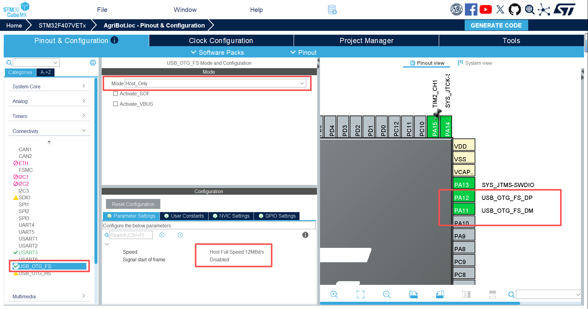
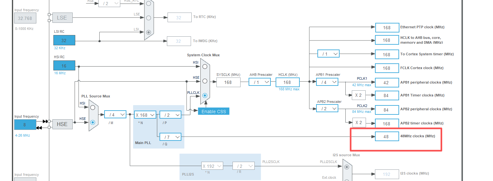
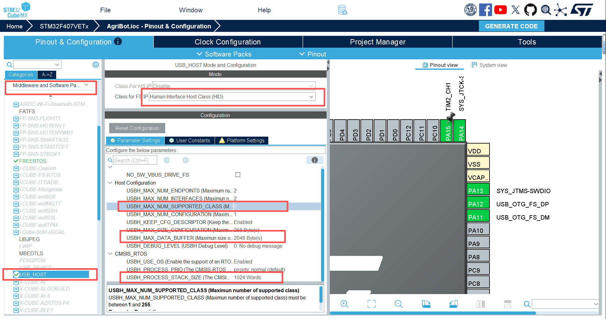
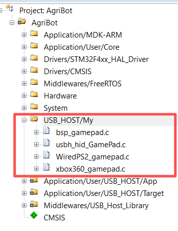

# 简介

这是一个基于stm32的农业机器人项目，使用stm32f407vet6作为主控制器，采用HAL库+FreeRTOS操作系统进行开发。目的是实现农业小车的底盘控制，包括四驱电机、IMU传感器、串口通信、OLED显示等功能，协同jeston环境下ros2进行通信，并实现在玉米行间的自动导航和控制。

# 技术实现

## 手柄控制

手柄控制采用USB HID协议，使用GamePad_HID_Class类和GamePad_NonStdHID_Class类进行处理。

使用CubeMx配置，在connectivi中选择USB_OTG_FS，Mode：Host Only，选择全速12MB，默认使用PA11和PA12引脚，使用此模式后，时钟树中48MHz时钟便可以进行调节，该时钟一般如其名字一样配置为48MHz即可。





然后在Middlewares选择USB_HOST进行配置。

注意选择 HID，然后配置最大类数量2，数据buffer2048还有进程栈大小1024字节。



配置完成以后，生成keil代码，然后在keil中进行移植。keil新建一个文件夹，放置手柄驱动库。



在usb_host.c中做出如下更改。注册两个手柄的类，添加回调函数。MX_USB_HOST_Init()的更改如下类似，使用#if #endif进行更改，添加在一个USER CODE  BEGIN 和 USER CODE END中，这样下次使用CubeMx更改就不需要进来再次修改函数。

```c++
void MX_USB_HOST_Init(void)
{
  /* USER CODE BEGIN USB_HOST_Init_PreTreatment */
  // 手柄默认接口
  GamePadInterface = &GamePadDefalut;

  extern USBH_ClassTypeDef GamePad_HID_Class;
  extern USBH_ClassTypeDef GamePad_NonStdHID_Class;

  if (USBH_Init(&hUsbHostFS, USBH_UserProcess, HOST_FS) != USBH_OK)
  {
    Error_Handler();
  }
  if (USBH_RegisterClass(&hUsbHostFS, &GamePad_HID_Class) != USBH_OK) // 注册ps2 hid类
  {
    Error_Handler();
  }
  if (USBH_RegisterClass(&hUsbHostFS, &GamePad_NonStdHID_Class) != USBH_OK) // 注册无线手柄ps2 hid类
  {
    Error_Handler();
  }

  if (USBH_Start(&hUsbHostFS) != USBH_OK)
  {
    Error_Handler();
  }
#if 0
  /* USER CODE END USB_HOST_Init_PreTreatment */

  /* Init host Library, add supported class and start the library. */
  if (USBH_Init(&hUsbHostFS, USBH_UserProcess, HOST_FS) != USBH_OK)
  {
    Error_Handler();
  }
  if (USBH_RegisterClass(&hUsbHostFS, USBH_HID_CLASS) != USBH_OK)
  {
    Error_Handler();
  }
  if (USBH_Start(&hUsbHostFS) != USBH_OK)
  {
    Error_Handler();
  }
  /* USER CODE BEGIN USB_HOST_Init_PostTreatment */
#endif
  /* USER CODE END USB_HOST_Init_PostTreatment */
}
#include "system.h"

extern USBH_StatusTypeDef USBH_HID_PS2_Decode(USBH_HandleTypeDef *phost);

// usb数据读取后,最终进入此回调函数.数据解码在此函数进行(任务环境)
void USBH_HID_EventCallback(USBH_HandleTypeDef *phost)
{
  // 游戏手柄数据解码
  USBH_HID_PS2_Decode(phost);

  // 游戏手柄模式启动
  if (GamePadInterface->StartFlag == 1 && PS2_ON_Flag == 0 && SysVal.Time_count >= CONTROL_DELAY && GamePadInterface->LY > 150)
  {
    PS2_ON_Flag = 1, Remote_ON_Flag = 0, APP_ON_Flag = 0, CAN_ON_Flag = 0, Usart1_ON_Flag = 0, Usart5_ON_Flag = 0;
  }
}
```

然后需要在一个文件中添加手柄解码的一些回调函数，我添加在CarControl.c中，如下：

```c++
#include "xbox360_gamepad.h"
#include "WiredPS2_gamepad.h"
// xbox360游戏手柄按键回调函数
void Xbox360GamePad_KeyEvent_Callback(uint8_t keyid, GamePadKeyEventType_t event)
{
    // 按下start按键
    if (keyid == Xbox360KEY_Menu && event == GamePadKeyEvent_SINGLECLICK)
        GamePadInterface->StartFlag = 1;

    if (gamepad_brand == Xbox360)
    {
        // 手柄加减速
        if (keyid == Xbox360KEY_LB && (event == GamePadKeyEvent_DOUBLECLICK || event == GamePadKeyEvent_SINGLECLICK))
            RC_Velocity -= 50;
        else if (keyid == Xbox360KEY_RB && (event == GamePadKeyEvent_DOUBLECLICK || event == GamePadKeyEvent_SINGLECLICK))
            RC_Velocity += 50;

        if (RC_Velocity < 0)
            RC_Velocity = 0;
    }
    else if (gamepad_brand == PS2_USB_Wiredless)
    {
        if (keyid == Xbox360KEY_LB && (event == GamePadKeyEvent_DOUBLECLICK || event == GamePadKeyEvent_SINGLECLICK))
            RC_Velocity += 50;
        else if (keyid == Xbox360_PaddingBit && (event == GamePadKeyEvent_DOUBLECLICK || event == GamePadKeyEvent_SINGLECLICK))
            RC_Velocity -= 50;
        if (RC_Velocity < 0)
            RC_Velocity = 0;
    }

    // 震动激活与取消
    if (keyid == Xbox360KEY_SELECT && event == GamePadKeyEvent_LONGCLICK)
    {
        if (GamePadInterface->Vib_EN)
        {
            GamePadInterface->SetVibration(0, 127);
            vTaskDelay(50);
            GamePadInterface->Vib_EN = !GamePadInterface->Vib_EN;
        }
        else
        {
            GamePadInterface->Vib_EN = !GamePadInterface->Vib_EN;
            vTaskDelay(50);
            GamePadInterface->SetVibration(0, 127);
        }
    }
}

// 有线USB手柄回调函数
void Wired_USB_PS2GamePad_KeyEvent_Callback(uint8_t keyid, GamePadKeyEventType_t event)
{
    // 按下start按键
    if (keyid == PS2KEY_START && event == GamePadKeyEvent_SINGLECLICK)
        GamePadInterface->StartFlag = 1;

    // 手柄加减速
    else if (keyid == PS2KEY_L2 && (event == GamePadKeyEvent_DOUBLECLICK || event == GamePadKeyEvent_SINGLECLICK))
        RC_Velocity -= 50;
    else if (keyid == PS2KEY_L1 && (event == GamePadKeyEvent_DOUBLECLICK || event == GamePadKeyEvent_SINGLECLICK))
        RC_Velocity += 50;

    if (RC_Velocity < 0)
        RC_Velocity = 0;
}

// 经典PS2手柄回调函数,非USB款
void Classic_PS2GamePad_KeyEvent_Callback(uint8_t keyid, GamePadKeyEventType_t event)
{
    // 按下start按键
    if (keyid == PS2KEY_START && event == GamePadKeyEvent_SINGLECLICK)
        GamePadInterface->StartFlag = 1;

    // 手柄加减速
    else if (keyid == PS2KEY_L2 && (event == GamePadKeyEvent_DOUBLECLICK || event == GamePadKeyEvent_SINGLECLICK))
        RC_Velocity -= 50;
    else if (keyid == PS2KEY_L1 && (event == GamePadKeyEvent_DOUBLECLICK || event == GamePadKeyEvent_SINGLECLICK))
        RC_Velocity += 50;

    if (RC_Velocity < 0)
        RC_Velocity = 0;
}

// 手柄震动映射函数
static uint8_t map_to_vib(float x)
{
    // 检查输入范围，限制在 [0.2, 1.2] 内
    if (x < 0.1f)
        return 0;
    if (x > 1.2f)
        x = 1.2f;

    // 线性映射
    float result = 255.0f * (x - 0.1f) / 1.1f;

    // 四舍五入并转换为 uint8_t
    return (uint8_t)(result + 0.5f);
}

void PS2_control(Robot_t *pRobot, IMU_DATA_t *pIMUData)
{
    float LX = 127, LY = 127, RX = 127;
    float ThrottleTri = 255;

    // 前进摇杆
    LY = GamePadInterface->LY - 127;

    // 左右横移
    LX = 127 - GamePadInterface->LX;

    // 顺逆时针
    RX = 127 - GamePadInterface->RX;
    // 输出 GamePadInterface 的全部数据
    // printf("LX: %d, LY: %d, RX: %d, LT: %d, RT: %d\r\n",
    //        GamePadInterface->LX, GamePadInterface->LY, GamePadInterface->RX, GamePadInterface->LT, GamePadInterface->RT);
    // 摇杆微小幅度过滤
    if (fabs(LY) < 20)
        LY = 0;
    if (fabs(LX) < 20)
        LX = 0;
    if (fabs(RX) < 20)
        RX = 0;

    // 针对xbox360手柄，扳机为模拟量时，允许使用扳机控制
    if (gamepad_brand == Xbox360)
    {
        // 前进摇杆无值时,采用扳机的值
        if ((int)LY == 0)
        {
            if (GamePadInterface->LT == 0 && GamePadInterface->RT != 0)
                ThrottleTri = GamePadInterface->RT, LY = 127;
            else if (GamePadInterface->LT != 0 && GamePadInterface->RT == 0)
                ThrottleTri = -GamePadInterface->LT, LY = 127;
            else
                ThrottleTri = 0;
        }
    }

    // 针对usb有线手柄,在非模拟量模式下的摇杆值映射
    else if (gamepad_brand == PS2_USB_Wired || gamepad_brand == PS2_USB_WiredV2)
    {
        if (fabs(RX) < 0.0001f)
        {
            if (GamePadInterface->getKeyState(PS2KEY_4PINK))
                RX = 127;
            else if (GamePadInterface->getKeyState(PS2KEY_2RED))
                RX = -127;
        }
    }

    // Handle PS2 controller control commands
    // 对PS2手柄控制命令进行处理

    pRobot->MoveSpeed.X_Speed = (LY / 127.0f) * RC_Velocity * (ThrottleTri / 255.0f);
    pRobot->MoveSpeed.Y_Speed = (LX / 127.0f) * RC_Velocity;
    pRobot->MoveSpeed.Z_Speed = (PI / 2) * (RX / 127.0f) * (RC_Velocity / 500.0f);

    //		Move_X=LX*RC_Velocity/128;
    //		Move_Y=LY*RC_Velocity/128;
    //		Move_Z=RY*(PI/2)/128;

    // Z-axis data conversion //Z轴数据转化
    // if (Car_Mode == Mec_Car || Car_Mode == Omni_Car || Car_Mode == Mec_Car_V550)
    // {
    //     Move_Z = Move_Z * RC_Velocity / 500;
    // }
    // else if (Car_Mode == Akm_Car)
    // {
    //     // Ackermann structure car is converted to the front wheel steering Angle system target value, and kinematics analysis is pearformed
    //     // 阿克曼结构小车转换为前轮转向角度
    //     Move_Z = Move_Z * 2 / 9;
    // }
    // else if (Car_Mode == Diff_Car || Car_Mode == Tank_Car || Car_Mode == FourWheel_Car || Car_Mode == FourWheel_Car_V550)
    // {
    if (pRobot->MoveSpeed.X_Speed < 0)
        pRobot->MoveSpeed.Z_Speed = -pRobot->MoveSpeed.Z_Speed; // The differential control principle series requires this treatment //差速控制原理系列需要此处理
    pRobot->MoveSpeed.Z_Speed = pRobot->MoveSpeed.Z_Speed * RC_Velocity / 500;
    // }

    // Unit conversion, mm/s -> m/s
    // 单位转换，mm/s -> m/s
    pRobot->MoveSpeed.X_Speed = pRobot->MoveSpeed.X_Speed / 1000;
    pRobot->MoveSpeed.Y_Speed = pRobot->MoveSpeed.Y_Speed / 1000;
    pRobot->MoveSpeed.Z_Speed = pRobot->MoveSpeed.Z_Speed;

    // Control target value is obtained and kinematics analysis is performed
    // 得到控制目标值，进行运动学分析
    InverseKinematic(pRobot);
    VelocityPIDControl(pRobot);

// 根据加速度反应震动情况传达到手柄
#include "bsp_gamepad.h"

    // Z轴数据判断震动强度
    float now_z = pIMUData->accel.z / 1671.84f;
    static float last_z = 0;
    float strength = fabs(last_z - now_z);

    // 震动映射到手柄
    if (strength > 0.1f && SysVal.Time_count > CONTROL_DELAY)
    {
        if (GamePadInterface->SetVibration != NULL)
            GamePadInterface->SetVibration(map_to_vib(strength), 0);
    }
    last_z = now_z;
}

```

这样添加完成以后，所有的手柄数据就会存在**GamePadInterface**中，然后使用**PS2_control**就可以进行控制了。

:red_circle:存在的一些问题：

在**usbh_hid_GamePad.c**的**static USBH_StatusTypeDef USBH_HID_InterfaceInit(USBH_HandleTypeDef *phost)**中，进行手柄id确认的时候，有时会出现id错误的问题，到目前为止没找到解决办法，所以进行如下处理，使其错误的时候也进入回调函数解码，貌似就好使了。如果有解决办法再次进行更新。

```c++
  else if ((device_pid == Xbox360_GamePad_PID && device_vid == Xbox360_GamePad_VID) || (device_pid == 0x126 && device_vid == 0x79))
```

