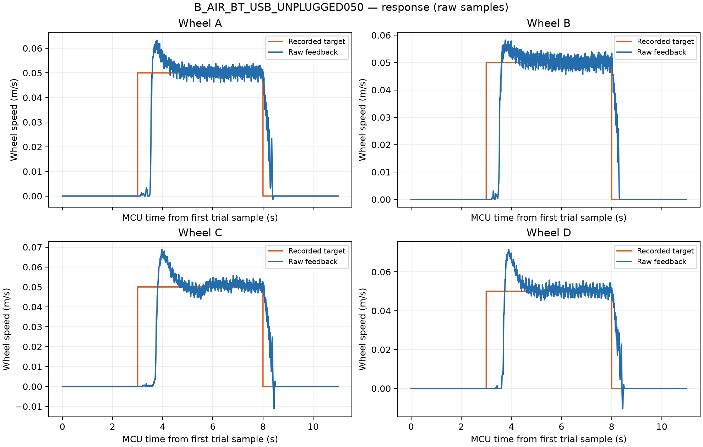

# 拔除 USB 串口后的蓝牙观察测试

目标 0.05 m/s；静止 3 秒、运行 5 秒、停车 3 秒。使用 COM13 蓝牙，检测时 COM12 不存在。小车按既有持续架空授权测试。

1100 个运行阶段样本完整，整个采集 3245 样本；无缺失序号、CRC 错误或队列丢样。四轮 HOLD 净计数均为正，末 100 ms 反馈全零，COMPLETE 输出全零。

保持段最后 2 秒平均速度（原始记录统计，无滤波）：

- A：0.05029 m/s
- B：0.05019 m/s
- C：0.05095 m/s
- D：0.05030 m/s

低速仍有逐周期波动，按预先定义的 ±5% 误差带并要求保持至末尾，四轮均未满足稳定判据；本次用于通信与运动观察，不替代正式基线，不修改 PI。

原始速度、PWM、误差和周期图在 figures 目录。操作者本次实际视觉观察尚未反馈。

